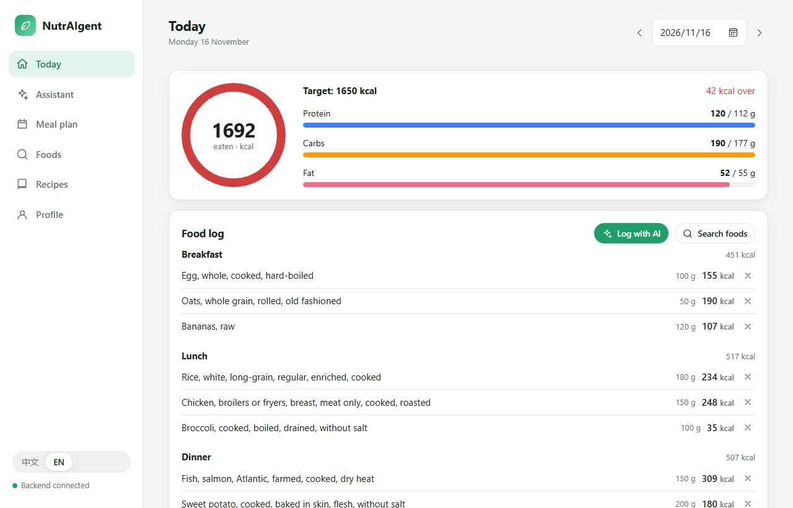
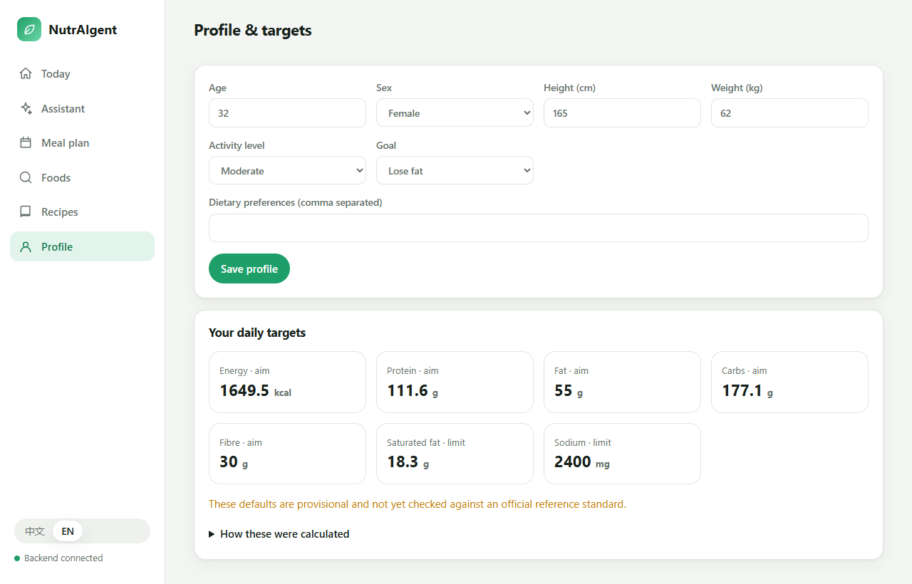

# NutrAIgent

Local nutrition tracker with an optional AI assistant. Data stays on your machine.

[中文](#中文) · [English](#english)



---

## 中文

### 1. 获取与准备

- 下载源码（[Download ZIP](https://github.com/YiCQi/NutrAIgent)，或 `git clone https://github.com/YiCQi/NutrAIgent.git`）。
- 安装 [Python 3.11+](https://www.python.org/downloads/)（勾选 *Add to PATH*）和 [Node.js LTS](https://nodejs.org/)。

### 2. 启动

双击 `start.bat`。首次运行会安装依赖，需要几分钟；完成后浏览器打开 http://127.0.0.1:8000 。关闭窗口即停止。

### 3. 导入食物数据（仅一次）

未导入时食物搜索为空。下载以下数据集并解压到对应目录：

| 数据集 | 下载 | 放置位置 |
|---|---|---|
| 英国 CoFID 2021（xlsx） | [GOV.UK](https://www.gov.uk/government/publications/composition-of-foods-integrated-dataset-cofid) | `backend\data\raw\cofid\CoFID_2021.xlsx` |
| USDA SR Legacy（CSV） | [FDC](https://fdc.nal.usda.gov/download-datasets/) | `backend\data\raw\usda_sr_legacy\` |
| USDA Foundation Foods（JSON） | [FDC](https://fdc.nal.usda.gov/download-datasets/) | `backend\data\raw\usda_foundation_json\` |

在项目根目录运行：

```bash
.\backend\.venv\Scripts\python backend\scripts\import_cofid.py
.\backend\.venv\Scripts\python backend\scripts\import_usda_sr_legacy.py
.\backend\.venv\Scripts\python backend\scripts\import_usda_foundation.py
```

文件名不同时，加 `--xlsx <文件>` 或 `--json <文件>`。

### 4. 使用

- **个人资料**：填写基本信息与目标，计算每日热量和营养目标。
- **今天**：查看当日摄入与目标的差距。
- **食物**：搜索并按克数记录。
- **食谱**：保存常用菜品，营养由配料自动计算。
- **助手**（需 AI）：用自然语言描述饮食，确认提案后保存。
- **餐单**（需 AI）：生成多日计划，调整后记入日志。

| 助手 | 食谱 | 个人资料 |
|---|---|---|
|  |  |  |

### 5. 配置 AI（可选）

在 **助手** 页展开 **AI 服务设置**，选择服务商（Anthropic、OpenAI 兼容接口、OpenRouter、Ollama 等），填写模型名和密钥。

聊天内容及回复所需的食物数据会发送给所选服务商；使用本地模型（如 Ollama）时数据不离开本机。密钥以明文存于本地数据库。营养数值只来自本地数据库，AI 不生成数值。

### 常见问题

- **`start.bat` 无反应**：检查 Python 与 Node.js 是否在 PATH 中。
- **端口 8000 被占用**：运行 `.\start.ps1 -Port 9000`。
- **目标旁显示"临时"**：计算公式尚未与官方标准核对，见 [技术说明](docs/zh/technical.md#目标计算临时)。
- **数据位置**：`%USERPROFILE%\.nutraigent\nutraigent.db`，备份此文件即可。

> 本应用不提供医疗建议。

---

## English

### 1. Get and prepare

- Get the source ([Download ZIP](https://github.com/YiCQi/NutrAIgent), or `git clone https://github.com/YiCQi/NutrAIgent.git`).
- Install [Python 3.11+](https://www.python.org/downloads/) (tick *Add to PATH*) and [Node.js LTS](https://nodejs.org/).

### 2. Start

Run `start.bat`. The first run installs dependencies and takes a few minutes; the app then opens at http://127.0.0.1:8000 . Close the window to stop.

### 3. Load food data (once)

Food search is empty until this is done. Download and extract these datasets:

| Dataset | Download | Extract to |
|---|---|---|
| UK CoFID 2021 (xlsx) | [GOV.UK](https://www.gov.uk/government/publications/composition-of-foods-integrated-dataset-cofid) | `backend\data\raw\cofid\CoFID_2021.xlsx` |
| USDA SR Legacy (CSV) | [FDC](https://fdc.nal.usda.gov/download-datasets/) | `backend\data\raw\usda_sr_legacy\` |
| USDA Foundation Foods (JSON) | [FDC](https://fdc.nal.usda.gov/download-datasets/) | `backend\data\raw\usda_foundation_json\` |

From the project root:

```bash
.\backend\.venv\Scripts\python backend\scripts\import_cofid.py
.\backend\.venv\Scripts\python backend\scripts\import_usda_sr_legacy.py
.\backend\.venv\Scripts\python backend\scripts\import_usda_foundation.py
```

If file names differ, pass `--xlsx <file>` or `--json <file>`.

### 4. Use

- **Profile**: enter basics and goal; daily energy and nutrient targets are calculated.
- **Today**: intake versus targets for the day.
- **Foods**: search and log by grams.
- **Recipes**: save common dishes; nutrients come from ingredients.
- **Assistant** (needs AI): describe what you ate in plain language, review the proposal, confirm.
- **Meal plan** (needs AI): generate a multi-day plan, adjust, log to diary.

| Assistant | Recipes | Profile |
|---|---|---|
|  |  |  |

### 5. Configure AI (optional)

On the **Assistant** page, expand **AI provider settings**. Choose a provider (Anthropic, OpenAI-compatible, OpenRouter, Ollama, etc.), then enter a model name and key.

Chat text and the food data needed for a reply go to the chosen provider; with a local model such as Ollama, data stays on your machine. The key is stored in plain text in the local database. Nutrient values come only from the local database; the AI does not generate them.

### Troubleshooting

- **`start.bat` does nothing**: check that Python and Node.js are on PATH.
- **Port 8000 in use**: run `.\start.ps1 -Port 9000`.
- **"Provisional" on targets**: formulas are not yet checked against an official standard. See [technical notes](docs/en/technical.md#calculation-provisional).
- **Data location**: `%USERPROFILE%\.nutraigent\nutraigent.db`. Back up this file.

> This app does not give medical advice.
