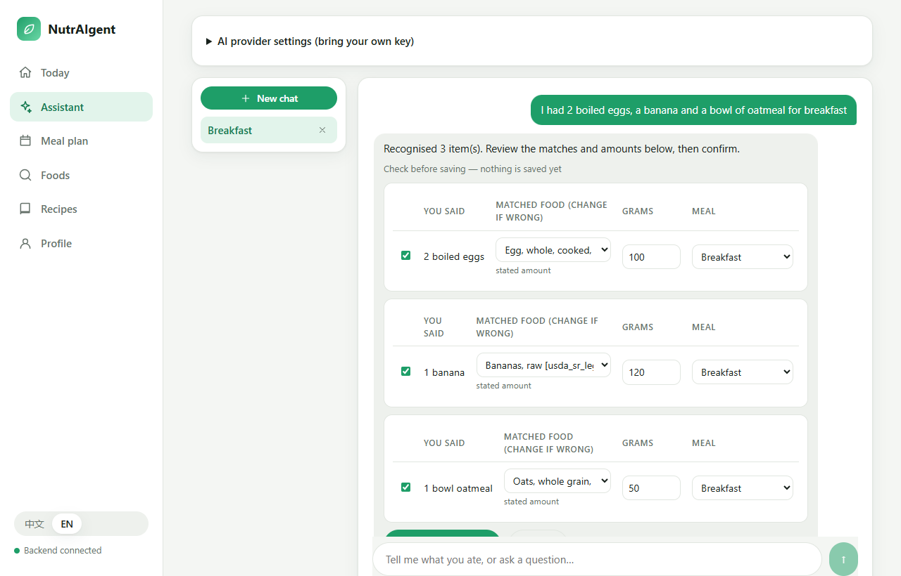
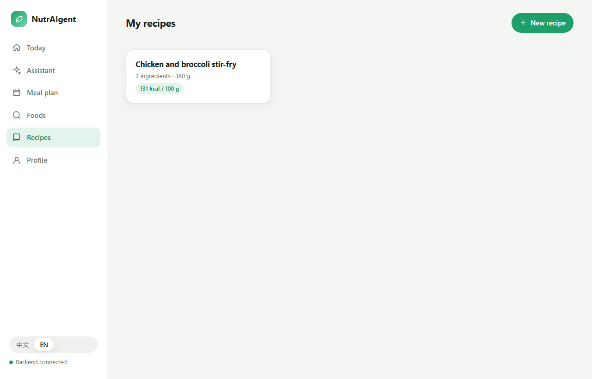

# NutrAIgent

Track your food and nutrition on your own computer, with an optional AI assistant. Your data stays on your machine.

[中文](#中文) · [English](#english)


---

## 中文

### 第一步：下载

1. 打开 https://github.com/YiCQi/NutrAIgent
2. 点击绿色的 **Code** 按钮，选择 **Download ZIP**。
3. 解压到任意文件夹。

### 第二步：安装两个软件（只需一次）

- [Python 3.11 或更高版本](https://www.python.org/downloads/)：安装时勾选 **Add python.exe to PATH**。
- [Node.js LTS](https://nodejs.org/)：默认选项安装即可。

### 第三步：启动

双击解压文件夹里的 **`start.bat`**。

- 首次启动需要几分钟，用于安装组件。
- 浏览器会自动打开 http://127.0.0.1:8000
- 关闭黑色窗口即可停止应用。

### 第四步：导入食物数据（只需一次）

没有这一步，食物搜索是空的。需要先完成第三步。

1. 下载以下三份免费数据：
   - **英国 CoFID 2021**：https://www.gov.uk/government/publications/composition-of-foods-integrated-dataset-cofid
     下载 xlsx 文件，保存为 `backend\data\raw\cofid\CoFID_2021.xlsx`。
   - **美国 USDA SR Legacy（CSV）**：https://fdc.nal.usda.gov/download-datasets/
     下载后解压到 `backend\data\raw\usda_sr_legacy\`。
   - **美国 USDA Foundation Foods（JSON）**：同一页面。
     下载后解压到 `backend\data\raw\usda_foundation_json\`。
2. 在项目文件夹中打开 PowerShell 或命令提示符，依次运行：

```bash
.\backend\.venv\Scripts\python backend\scripts\import_cofid.py
```

```bash
.\backend\.venv\Scripts\python backend\scripts\import_usda_sr_legacy.py
```

```bash
.\backend\.venv\Scripts\python backend\scripts\import_usda_foundation.py
```

> 如果下载的文件名与上面不同，在命令后加上 `--xlsx 文件路径`（CoFID）或 `--json 文件路径`（Foundation）。

### 第五步：开始使用

1. **个人资料**：填写年龄、性别、身高、体重、活动量和目标，然后保存。应用会计算每日热量和营养目标。
2. **今天**：查看今天吃了什么，以及与目标的差距。
3. **食物**：搜索食物（如"鸡蛋""米饭"），选择克数后加入今天的记录。
4. **食谱**：保存常做的菜，应用会根据配料自动计算营养。
5. **助手**（需先设置 AI，见第六步）：直接描述你吃了什么，例如"早餐两个鸡蛋和一碗白米饭"。检查提案，点击**确认**后保存。
6. **餐单**（需先设置 AI）：生成几天的饮食计划，可调整后记录到每日日志。

| 助手 | 食谱 | 个人资料 |
|---|---|---|
|  |  |  |

### 第六步：设置 AI（可选）

助手和餐单需要你自己的 AI 服务密钥，例如 Anthropic、OpenAI、OpenRouter，或本地的 Ollama。

1. 打开 **助手** 页面，展开 **AI 服务设置**。
2. 选择服务商，填写模型名和密钥，然后保存。

**隐私说明：** 你的聊天文字，以及回复所需的食物数据，会发送给你选择的服务商。如果使用本地模型（如 Ollama），数据不会离开你的电脑。密钥保存在本机数据库中。营养数值始终来自本地数据库，AI 不会自行编造数值。

### 常见问题

- **双击 `start.bat` 没有反应**：确认已安装 Python 和 Node.js，并重新打开应用。
- **8000 端口被占用**：关闭占用该端口的程序，或运行 `.\start.ps1 -Port 9000` 换一个端口。
- **搜不到食物**：完成第四步。
- **目标旁显示"临时"**：目标的计算方法尚未与官方标准核对，详见[技术说明](docs/zh/technical.md#目标计算临时)。
- **数据保存在哪里**：`C:\Users\<用户名>\.nutraigent\nutraigent.db`。备份这一个文件即可备份全部数据。

> 本应用不提供医疗建议。如有健康问题，请咨询专业人士。

更多技术细节见 [技术说明](docs/zh/technical.md)。

---

## English

### Step 1: Download

1. Open https://github.com/YiCQi/NutrAIgent
2. Click the green **Code** button and choose **Download ZIP**.
3. Extract the ZIP to any folder.

### Step 2: Install two programs (once)

- [Python 3.11 or newer](https://www.python.org/downloads/): tick **Add python.exe to PATH** during setup.
- [Node.js LTS](https://nodejs.org/): default options are fine.

### Step 3: Start

Double-click **`start.bat`** in the extracted folder.

- The first start takes a few minutes while components install.
- Your browser opens http://127.0.0.1:8000 automatically.
- Close the black window to stop the app.

### Step 4: Load food data (once)

Food search is empty until you do this. Complete Step 3 first.

1. Download these three free datasets:
   - **UK CoFID 2021**: https://www.gov.uk/government/publications/composition-of-foods-integrated-dataset-cofid
     Download the xlsx file and save it as `backend\data\raw\cofid\CoFID_2021.xlsx`.
   - **USDA SR Legacy (CSV)**: https://fdc.nal.usda.gov/download-datasets/
     Extract the download into `backend\data\raw\usda_sr_legacy\`.
   - **USDA Foundation Foods (JSON)**: same page.
     Extract the download into `backend\data\raw\usda_foundation_json\`.
2. Open PowerShell or Command Prompt in the project folder and run:

```bash
.\backend\.venv\Scripts\python backend\scripts\import_cofid.py
```

```bash
.\backend\.venv\Scripts\python backend\scripts\import_usda_sr_legacy.py
```

```bash
.\backend\.venv\Scripts\python backend\scripts\import_usda_foundation.py
```

> If your file names differ, add `--xlsx <file>` (CoFID) or `--json <file>` (Foundation) to the command.

### Step 5: Use the app

1. **Profile**: enter your age, sex, height, weight, activity level and goal, then save. The app calculates your daily energy and nutrient targets.
2. **Today**: see what you ate today and how it compares with your targets.
3. **Foods**: search for a food (e.g. "egg", "rice"), choose the amount and add it to today.
4. **Recipes**: save dishes you cook often. Nutrients are calculated from the ingredients.
5. **Assistant** (needs AI, see Step 6): describe what you ate, e.g. "two eggs and a bowl of white rice for breakfast". Check the proposal and click **Confirm** to save.
6. **Meal plan** (needs AI): generate a multi-day meal plan, adjust it, and log meals to your diary.

| Assistant | Recipes | Profile |
|---|---|---|
|  |  |  |

### Step 6: Set up AI (optional)

The assistant and meal plan need your own API key from a provider such as Anthropic, OpenAI, OpenRouter, or a local Ollama server.

1. Open the **Assistant** page and expand **AI provider settings**.
2. Choose a provider, enter a model name and your key, then save.

**Privacy:** your chat text and the food data needed for a reply are sent to the provider you chose. With a local model such as Ollama, data stays on your computer. Your key is stored in the local database. Nutrient values always come from the local food database; the AI does not invent them.

### Troubleshooting

- **Double-clicking `start.bat` does nothing**: check that Python and Node.js are installed, then try again.
- **Port 8000 is in use**: close the program using it, or run `.\start.ps1 -Port 9000`.
- **No foods found**: complete Step 4.
- **"Provisional" note on targets**: the target formulas have not yet been checked against an official reference. See the [technical notes](docs/en/technical.md#calculation-provisional).
- **Where is my data?** `C:\Users\<your name>\.nutraigent\nutraigent.db`. Back up this one file to back up everything.

> This app does not give medical advice. For health concerns, consult a professional.

More technical details: [technical notes](docs/en/technical.md).
